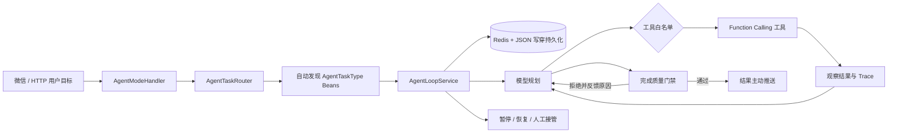

# 可持久化多场景 Agent 平台

这个项目不把 Agent 理解成一段更长的 Prompt，而是把它实现为一套由代码控制的任务运行时：模型负责提出下一步行动，框架负责权限、状态、预算、重试、持久化和最终质量。

## 架构



## 内置任务

| taskType | 适合演示的输入 | 核心亮点 |
| --- | --- | --- |
| `travel` | `8 月从上海去杭州玩两天，2 人预算 2000，给三种攻略` | 专用旅行工具、实时性标注、票务链接防幻觉 |
| `research` | `深度调研国内 AI 编程助手，输出有证据的行业报告` | Web + 私有 RAG、交叉验证、未检索 URL 拦截 |
| `learning` | `给我做一个六周 Spring Boot 学习计划，每周 8 小时` | 知识树、练习反馈闭环、阶段验收门禁 |
| `decision` | `帮我做 PostgreSQL 与 MySQL 技术选型` | 决策矩阵、权重、敏感性分析、风险边界 |
| `generic` | 任意多步骤目标 | 通用兜底，使用全部已注册工具 |

微信演示：

```text
/agent
深度调研国内 AI 编程助手，结合我的知识库输出一份带证据表的行业报告
```

任务会异步执行，完成后主动推送结果。执行期间可发送“停”“暂停”“继续”或“任务进度”。管理后台的“Agent 任务”页可以查看每一步 Trace、Token 使用量、人工接管请求和最终结果。

HTTP 演示：

```http
GET /api/agent/tasks/types

POST /api/agent/tasks
Content-Type: application/json

{
  "sessionId": "interview-demo",
  "taskType": "decision",
  "goal": "帮我做 PostgreSQL 与 MySQL 技术选型，团队 5 人，优先稳定性和运维成本"
}
```

## 为什么它适合面试展示

1. Agent 类型和工具一样都是插件式注册。新增场景只需实现 `AgentTaskType` 并声明为 Spring Bean，不修改路由器或 Loop。
2. 确定性约束放在代码侧。步数、Token、超时、工具权限和完成门禁不能被模型绕过。
3. 任务可恢复。每个 Loop 边界写入 Redis，并以本地 JSON 降级，进程重启后可找回中断任务。
4. 高风险动作有人机协作。需要登录、授权或外部确认时进入 `WAITING_HUMAN`，提交人工结果后从断点继续。
5. 全链路可观测。决策、行动、观察、恢复和终止事件形成 Trace，后台可直接审计。
6. RAG 不只用于聊天。调研和学习 Agent 可以把私有知识库证据与公网时效信息组合到同一任务中。

## 扩展一个新 Agent

实现 `AgentTaskType` 并提供一个 Spring Bean：

```java
@Component
class SecurityReviewTaskType implements AgentTaskType {
    public String name() { return "security-review"; }
    public boolean supports(String context) { return context.contains("安全审计"); }
    public int routingPriority() { return 80; }
    public Set<String> allowedTools() {
        return Set.of("search_knowledge_base", "search_web");
    }
    public String systemPrompt(AgentTask task) { return "..."; }
}
```

`AgentTaskRouter` 和 `AgentLoopService` 都会自动发现它。对于结果格式或证据要求，可覆写 `validateCompletion`，不合格结果会携带原因回到 Loop 自动修正。
