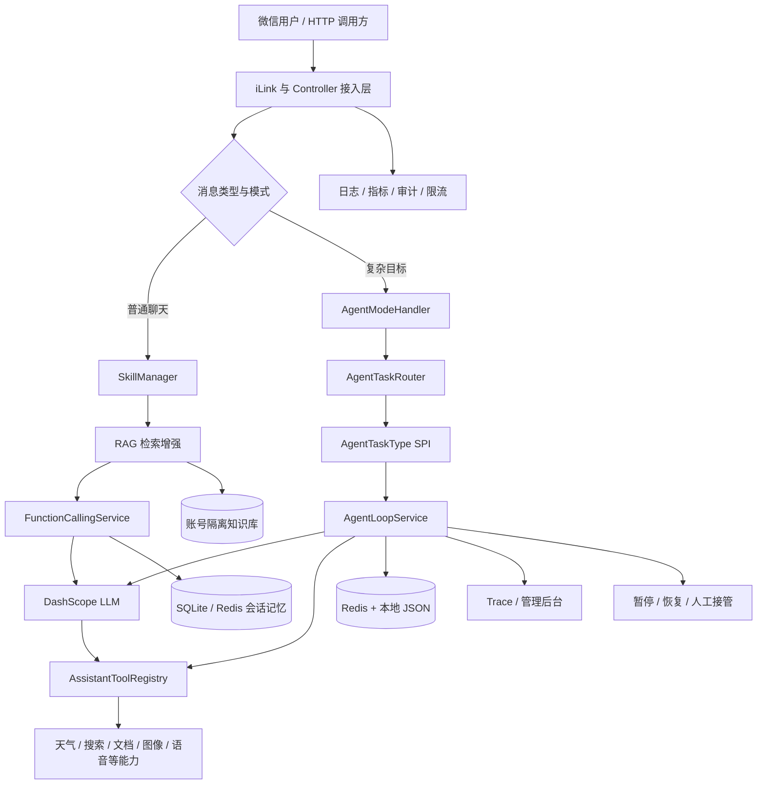
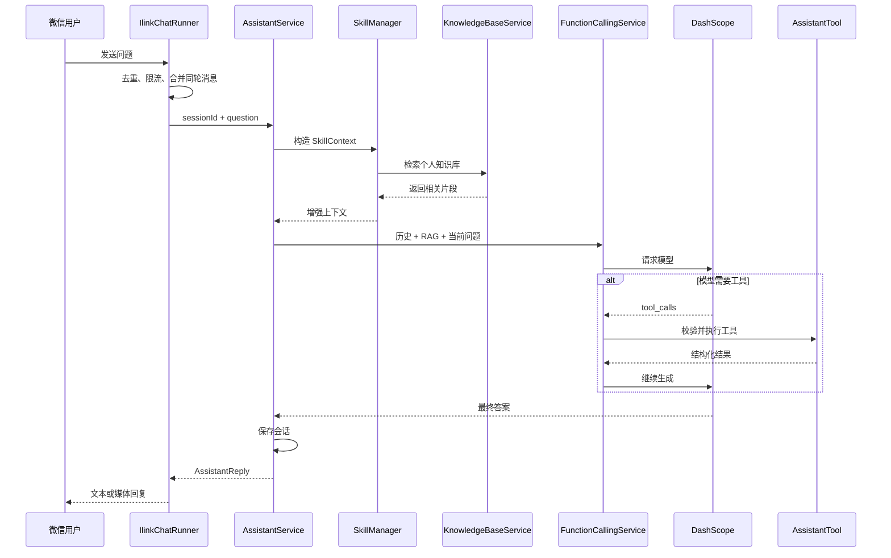

# 微信 AI 助手与可持久化多场景 Agent 平台

## 1. 项目简介

本项目是一套运行在微信中的个人 AI 助手，同时也是一个可扩展、可持久化、可观测的多场景 Agent 平台。

用户可以像与普通微信好友聊天一样使用它，完成知识问答、联网检索、个人知识库查询、天气查询、图片理解与编辑、文生图、文档处理、语音识别与合成、定时提醒等任务。对于旅游规划、深度调研、学习计划、技术选型等复杂目标，系统会进入 Agent 模式，自主拆解任务、调用工具、观察结果，并在满足质量要求后主动推送最终结果。项目还提供了一套完整的私有可视化控制台，用来管理微信机器人账号、知识库、会话、Agent 任务、日志、调用明细、用量和对话审计。

项目并没有把 Agent 简化为一段很长的提示词，而是把模型能力放进一套由程序控制的执行框架中：

- 模型负责理解目标、规划下一步和生成回答。
- 框架负责状态流转、工具权限、预算、重试、超时和持久化。
- 质量门禁负责拦截没有证据、格式不完整或存在幻觉的最终答案。
- 人工接管机制负责处理登录、授权、付款确认等不能自动完成的动作。
- Trace 和管理后台负责呈现完整执行过程。

因此，它既是一个可以真实使用的微信助手，也是一套适合展示 AI 应用工程能力的后端项目。

## 2. 项目定位

### 2.1 解决的问题

传统聊天机器人通常存在以下问题：

1. 只能回答问题，不能持续执行多步骤任务。
2. 模型知识有时效性，容易对新闻、价格和政策产生过时回答。
3. 无法访问用户自己的资料。
4. 工具调用容易重复、失控或产生未经验证的结果。
5. 长任务在进程重启后丢失。
6. 执行过程不可追踪，发生错误时难以定位。
7. 外部系统需要登录、授权时，没有合理的人机协作机制。

本项目通过 RAG、Function Calling、Agent Loop、持久化状态机和可观测体系解决这些问题。

### 2.2 适用场景

- 个人微信 AI 助手
- 私有知识库问答
- 多模态内容处理
- 长耗时、多步骤任务执行
- 旅游方案规划与票务导航
- 行业、竞品和技术调研
- 个性化学习计划
- 技术或采购方案选型
- AI Agent 工程实践与面试项目展示

## 3. 当前状态

上一版已部署在阿里云服务器并通过线上健康检查；当前 `1.0.0` 候选版本已在本地通过完整质量门禁，需重新部署后再更新线上制品哈希。

| 项目 | 当前状态 |
| --- | --- |
| 运行环境 | Linux + systemd + Java 21 |
| 服务状态 | `active` |
| 健康检查 | Actuator `UP` |
| Redis | `PONG` |
| 微信连接 | 已恢复两个 iLink 会话 |
| Agent 类型 | 旅游、调研、学习、决策、通用 |
| 自动注册 Skill | `rag-retrieval` |
| 回归测试 | 190 项通过，0 失败，0 错误 |
| 行覆盖率 | 48.43%，JaCoCo 门禁不低于 45% |
| 当前候选版本 | `wechat-agent-platform:1.0.0` |
| 线上状态 | 上一版在线；`1.0.0` 待重新部署 |

## 4. 核心能力

### 4.1 微信自然语言交互

系统通过微信 iLink SDK 接收和发送消息，用户无需安装额外客户端。

支持：

- 普通文本问答
- 多轮上下文对话
- 图片、视频、文档和音频附件
- 同一轮文字与附件自动合并
- “正在输入”状态
- 多微信账号管理
- 任务完成后的主动推送
- 对话重置、状态查询和模式切换命令

常用命令：

```text
/help       查看帮助
/status     查看运行状态
/version    查看版本
/reset      清除当前对话记忆
/agent      切换到 Agent 模式
/chat       切回普通聊天模式
```

### 4.2 多模态处理

系统可以统一处理多种输入和输出：

| 类型 | 能力 |
| --- | --- |
| 图片 | 图片理解、内容描述、图片编辑 |
| 视频 | 抽帧后交给多模态模型理解 |
| 文档 | TXT、PDF、Word、Excel、PowerPoint 内容提取与总结 |
| 音频 | WAV、MP3 等文件的语音识别 |
| 语音输出 | 将回答合成为语音文件 |
| 图像输出 | 文生图和图片编辑结果回传微信 |

微信中图片和文字经常不是同时到达。系统会设置短暂的批处理窗口，把同一用户连续发送的文字、图片和文档合并为一次请求，避免模型只看到附件或只看到指令。

最近上传的图片和文档还会保留一段时间，支持用户随后补充：

```text
把刚才那张图换成夜景
把上一个文件整理成摘要
比较刚才两张图片的差异
```

### 4.3 Function Calling 工具体系

所有模型工具都实现统一的 `AssistantTool` 接口，并由 `AssistantToolRegistry` 自动收集 Spring Bean。

当前主要工具包括：

- 联网搜索
- 个人知识库检索和资料写入
- 天气与未来天气查询
- 世界时间查询
- 科学计算
- 文档处理
- 图片生成和编辑
- 语音识别与合成
- 音色管理
- 定时提醒
- 日常信息查询
- 体脂率估算
- 旅游方案、景点、交通、票务和外部结算记录工具

新增工具时，只需要：

1. 实现 `AssistantTool`。
2. 提供工具定义、JSON Schema 和执行逻辑。
3. 声明为 Spring Bean。
4. 补充单元测试。

注册中心会自动发现新工具，不需要修改大型分发 `if-else`。

## 5. 私有可视化控制台

控制台不是简单的日志页面，而是整个 AI 助手的统一管理与可观测入口。它把原本需要通过命令行、Redis 或服务器日志完成的操作集中到浏览器中，让项目从“能运行的后端服务”提升为“可配置、可管理、可审计的完整产品”。

控制台入口：

```text
/api/admin/ilink/login
```

生产环境默认只监听服务器本机地址，建议通过 SSH 隧道访问，不直接暴露到公网。

### 5.1 登录与安全

控制台使用 `ADMIN_API_TOKEN` 验证管理权限。

登录流程：

1. 管理员输入 API Token，也可以直接粘贴 `ADMIN_API_TOKEN=...` 环境变量行。
2. 服务端使用常量时间比较校验 Token，降低时序侧信道风险。
3. 校验成功后生成 256 位随机会话 ID。
4. 浏览器获得短期 HTTP-only Session Cookie。
5. Cookie 使用 `SameSite=Strict`，前端 JavaScript 无法读取管理会话。
6. 管理 Token 不写入 Local Storage、Session Storage 或 Cookie。
7. 会话默认有效 8 小时，退出时立即撤销。

已有 API 仍兼容 `X-Admin-Token` 请求头，因此浏览器控制台和自动化运维脚本可以共用同一套后端能力。

控制台还支持识别从 Shell 或环境文件中复制的 Token，自动处理：

- `ADMIN_API_TOKEN=value`
- `export ADMIN_API_TOKEN=value`
- 单引号或双引号
- 剪贴板中的不可见零宽字符

### 5.2 账号连接工作区

控制台可以管理多个微信机器人账号：

- 创建新的机器人账号。
- 为账号设置易读的显示名称。
- 查看在线、等待扫码或异常状态。
- 获取微信登录二维码。
- 轮询扫码登录进度。
- 重启连接。
- 重新扫码认证。
- 删除非默认账号。

重新认证只断开当前连接，不会直接删除已有会话和知识库。删除账号属于高风险操作，前端会要求用户确认。

### 5.3 知识库工作区

知识库页面按照机器人账号隔离资料：

- 选择目标机器人。
- 上传 PDF、Word、Excel、PowerPoint、TXT、Markdown、CSV、JSON、YAML 等文件。
- 自动提取内容并建立轻量检索索引。
- 查看文件名、大小和更新时间。
- 删除指定资料。

账号级隔离非常重要：同一套服务可以连接多个微信机器人，但每个机器人只能检索自己的资料，避免不同用途的知识内容互相污染。

### 5.4 会话数据工作区

会话页面展示 SQLite 中保存的上下文：

- 按机器人账号筛选。
- 按最新访问时间排序。
- 展示用户问题、助手回答和历史摘要。
- 编辑会话摘要。
- 删除单个会话。
- 清空指定机器人的全部会话。
- 每两秒检查是否出现新消息。

自动刷新采用“阅读保护”设计：当管理员正在滚动查看长对话时，新数据不会突然重绘页面，而是提示点击刷新，避免打断阅读位置。

### 5.5 Agent 任务工作区

Agent 页面是展示本项目工程深度最直观的界面。

它会按微信用户和会话对任务分组，并展示：

- 用户目标
- 任务 ID
- 自动选择的任务类型
- 当前状态
- 已执行步骤和最大步骤
- 已使用 Token 和预算
- 终止原因
- 人工接管请求
- 最终答案或错误摘要

管理员可以直接执行：

- 查看完整 Trace
- 暂停任务
- 恢复任务
- 取消任务
- 重试失败任务
- 提交人工处理结果
- 删除已结束任务

Trace 会呈现任务创建、模型决策、工具行动、结果观察、错误恢复、人工接管和终止等事件，使 Agent 不再是无法解释的黑盒。

### 5.6 运行日志工作区

日志页面可以：

- 查看最近 24 小时日志。
- 汇总全部机器人账号的运行信息。
- 手动刷新。
- 下载 `.log` 文件。

日志已经过敏感信息处理，不展示 API Key、管理令牌和附件原始字节。

### 5.7 工具调用明细

调用明细页面展示最近的工具执行记录：

- 工具名称
- 调用时间
- 所属会话
- 执行耗时
- 成功或失败
- 脱敏后的错误摘要

这能快速判断问题来自模型决策、工具参数、外部 API 还是网络超时。

### 5.8 用量日报

用量数据按天写入 Redis，因此应用重启后仍然保留。

控制台可以查看最近七天：

- 每种工具的调用次数
- 失败次数
- 平均耗时
- 每日调用总量

它既可以用于稳定性分析，也可以帮助评估联网搜索、生图等计费工具的成本。

### 5.9 对话审计

对话审计默认关闭，需要管理员主动确认后开启。

开启后：

- 记录微信问题和回答。
- 保留会话标识和时间。
- 默认保留七天。
- 可以随时关闭。
- 关闭后仍可查看历史记录。

这个设计体现了“排障能力”和“隐私最小化”的平衡：系统具备审计能力，但不会默认收集用户对话。

### 5.10 产品设计与交互

控制台采用响应式单页工作区设计：

- 桌面端使用清晰的顶部品牌栏和工作区导航。
- 登录页通过安全视觉和三张功能卡片建立信息层级。
- 操作结果使用 Toast 反馈。
- 危险操作使用确认对话框。
- 状态使用统一 Tag 表达。
- 在窄屏设备上自动切换为单列布局和横向滚动导航。

登录、退出、有效 Token、无效 Token、HTTP-only 会话、浏览器控制台错误和响应式布局都经过浏览器 Design QA 验证。

### 5.11 控制台为什么是项目亮点

控制台把项目中最难展示的部分变成了可视化证据：

- 多账号隔离不是口头描述，可以直接切换账号验证。
- RAG 资料可以现场上传并立即提问。
- 会话持久化可以直接看到真实上下文。
- Agent 状态机、Token 预算和执行 Trace 可以现场展示。
- 工具调用和错误可以精确定位。
- 审计默认关闭体现隐私意识。
- 登录会话设计体现 Web 安全能力。

面试时，建议先打开控制台，再从微信发起任务。这样可以一边展示用户体验，一边在控制台观察后端执行过程。

## 6. 总体架构



### 6.1 分层说明

| 层次 | 主要职责 |
| --- | --- |
| 接入层 | 微信 iLink、HTTP API、附件下载、消息合并、主动推送 |
| 对话层 | 上下文记忆、Skill 增强、Function Calling、回复组装 |
| Agent 层 | 任务路由、状态机、规划循环、恢复策略、质量门禁 |
| 工具层 | 外部 API、本地计算、文档、知识库、旅游领域操作 |
| 持久化层 | SQLite、Redis、本地 JSON、知识库文件 |
| 运维层 | 管理后台、健康检查、指标、日志、调用审计 |

## 7. 普通消息处理流程

一条普通文本消息的处理过程如下：



关键设计：

- 会话按 `accountId::微信用户ID` 隔离。
- RAG 在调用 LLM 之前执行。
- RAG 失败不会阻断普通聊天。
- 工具结果以结构化内容回传模型。
- 同一调用链限制总工具次数，并阻止无意义重复调用。
- 失败动作不能被模型描述为已经成功。

## 8. Skill 插件协议

Skill 用于在消息进入模型前执行可插拔的上下文增强。

核心接口包含：

```java
public interface Skill {
    String id();
    default int order() { return 0; }
    default boolean supports(SkillContext context) { return true; }
    SkillContribution apply(SkillContext context);
}
```

### 8.1 自动加载机制

`SkillManager` 通过 Spring 注入 `List<Skill>`：

- 启动时自动发现全部 Skill Bean。
- 校验 Skill ID 是否为空或重复。
- 按 `order` 和 `id` 稳定排序。
- 逐个判断 `supports`。
- 合并所有有效的上下文贡献。
- 单个 Skill 失败时降级为空贡献，不影响正常聊天。

这使得新增 Skill 不需要修改管理器代码。

目前已实现：

| Skill | 作用 |
| --- | --- |
| `rag-retrieval` | 在生成前检索当前账号的个人知识库，并注入相关片段 |

后续可以继续封装：

- 用户画像 Skill
- 长期偏好 Skill
- 日历上下文 Skill
- 企业知识权限 Skill
- 安全策略 Skill
- 地理位置和时区 Skill

## 9. RAG：检索增强生成

### 9.1 工作流

RAG 的完整过程是：

```text
用户问题
   ↓
检索相关资料
   ↓
将资料作为受约束上下文注入 Prompt
   ↓
LLM 基于问题、历史与资料生成回答
```

对应三个阶段：

1. Retrieval：从用户知识库找到相关片段。
2. Augmentation：把片段包装为明确标注的上下文。
3. Generation：LLM 基于增强后的上下文回答。

### 9.2 当前实现

当前知识库采用轻量文件检索，适合个人项目和中小规模资料：

- 支持 Markdown、TXT、CSV、JSON、YAML、Properties、Java、XML、SQL。
- 单文件最大 2 MB。
- 最多扫描 1000 个文件。
- 按段落和窗口切片。
- 英文使用单词 Token。
- 中文使用单字和双字组合。
- 根据词频相关性评分并返回 Top K 片段。
- 每个微信机器人账号拥有独立知识库目录。

当前实现没有伪装成向量数据库。它的优点是部署简单、成本低、结果可解释；限制是语义召回能力弱于 Embedding + Vector Database。

### 9.3 防幻觉约束

注入给模型的 RAG 上下文会明确说明：

- 资料只在与问题相关时使用。
- 资料不足时必须明确说明。
- 不得把检索片段之外的信息冒充为知识库事实。

## 10. 可持久化 Agent 平台

### 10.1 Agent 与普通聊天的区别

普通聊天适合一次或少量工具调用；Agent 适合需要持续规划、执行和观察的复杂目标。

Agent Loop 基本流程：

```text
目标
 ↓
思考 / 决策
 ↓
调用一个工具
 ↓
观察工具结果
 ↓
更新任务状态
 ↓
继续规划，直到完成或触发终止条件
```

### 10.2 任务状态

典型状态包括：

- `PENDING`：等待执行或等待调度时间。
- `RUNNING`：正在执行。
- `PAUSED`：用户或系统要求暂停。
- `WAITING_HUMAN`：等待登录、授权或人工处理结果。
- `COMPLETED`：完成质量门禁并成功结束。
- `FAILED`：遇到不可恢复错误。
- `CANCELLED`：用户取消任务。

### 10.3 任务持久化

Agent 任务会在每个 Loop 边界保存：

- 任务 ID 和用户会话
- 任务类型与目标
- 当前状态
- 已执行步骤
- Token 使用量
- 截止时间和下次唤醒时间
- 模型与工具 Transcript
- 人工接管请求
- 最终答案或错误摘要

存储策略：

1. Redis 作为主要任务索引和调度存储。
2. 本地 JSON 文件作为降级存储。
3. 内存缓存采用写穿方式同步。
4. 服务启动后恢复被中断的运行中任务。

### 10.4 程序侧安全边界

每个任务类型都可以独立声明：

- 允许使用的工具白名单
- 最大推理步骤
- Token 预算
- 整体超时时间
- 重试次数和退避时间
- Loop 模式
- 最终答案质量门禁

这些限制由 Java 代码执行，而不是只写在 Prompt 中，因此模型不能自行绕过。

### 10.5 错误恢复

系统会对错误分类：

- 临时网络错误：退避后重试。
- 参数错误：把结构化错误返回模型，让模型修正参数。
- 上游不可用：使用降级结果或终止。
- 需要登录/授权：进入 `WAITING_HUMAN`。
- 达到预算、步骤或超时：由框架强制终止。

已成功执行的动作不会被重复执行，避免因模型重试造成重复副作用。

## 11. Agent 任务类型

任务类型实现 `AgentTaskType` 并声明为 Spring Bean。`AgentTaskRouter` 会自动发现、排序和匹配，无需维护中心场景判断表。

### 11.1 旅游攻略与票务 Agent

适合：

```text
8 月 10 日从上海去杭州玩两天，两个人预算 2000 元，给我三种方案
```

能力：

- 提取目的地、日期、人数、预算和偏好。
- 生成多种有明确取舍的行程方案。
- 查询天气、景点和交通信息。
- 保存结构化方案，支持“第二个方案怎么样”等追问。
- 提供固定、可验证的购票平台入口。
- 记录用户在外部平台完成的订单结果。
- 对链接、实时票价和库存进行严格真实性约束。

质量门禁会拒绝：

- 占位链接
- 未由工具返回的链接
- 虚假的实时票价或库存
- 没有工具依据却声称已经生成购票入口
- 不完整的固定购票平台入口

### 11.2 深度调研 Agent

适合：

```text
深度调研国内 AI 编程助手，结合我的知识库输出一份行业报告
```

能力：

- 把研究目标拆为 3 至 6 个子问题。
- 联合公网搜索和个人知识库。
- 对关键结论进行交叉验证。
- 区分事实、来源观点和模型推断。
- 输出执行摘要、关键发现、证据表、风险和下一步行动。

最终答案中的 URL 必须逐字来自工具结果，否则质量门禁会拒绝答案并要求模型修正。

### 11.3 学习教练 Agent

适合：

```text
给我制定一个六周 Spring Boot 学习计划，每周可以投入 8 小时
```

能力：

- 根据目标、基础、时间和截止日期制定计划。
- 优先利用个人知识库中的已有资料。
- 构建循序渐进的知识树。
- 使用费曼复述、主动回忆和间隔复习。
- 为每个阶段设计练习、测验和掌握标准。
- 用户明确要求后可创建学习提醒。

质量门禁要求最终结果必须包含学习目标、主动练习和阶段验收标准。

### 11.4 决策对比 Agent

适合：

```text
帮我做 PostgreSQL 与 MySQL 技术选型，优先稳定性和运维成本
```

能力：

- 提取候选方案、硬约束、评价维度和权重。
- 使用同一套标准比较所有候选项。
- 从知识库检索内部约束，从互联网核验外部事实。
- 使用计算工具完成评分。
- 输出决策矩阵和推荐结论。
- 分析哪些权重变化会导致结论翻转。

质量门禁要求最终答案必须包含评价标准、明确结论以及风险或不确定性。

### 11.5 通用 Agent

没有专业类型匹配时，使用通用任务类型兜底。它适合执行普通多步骤目标，但专业领域任务优先由受限工具集和专用质量门禁处理。

## 12. 旅游领域设计

旅游功能不仅是 Prompt，还包含独立领域模型和业务服务：

- 行程方案生成与存储
- 景点发现
- 交通方案查询
- 票务平台入口
- 外部结算记录
- 订单状态管理
- 取消与退款结果记录
- 旅游操作审计

系统不会在聊天窗口中收集身份证、银行卡、支付密码或短信验证码。实名和付款只能在供应商托管的 HTTPS 页面完成。

对于没有正式供应商 API 的数据，系统会明确标注：

- 估算
- 非实时
- 待核验
- 仅提供平台入口

这样可以避免把搜索结果或模型猜测包装成真实库存和订单。

## 13. 对话记忆与数据隔离

### 13.1 会话标识

微信会话采用：

```text
accountId::peerUserId
```

这个结构确保：

- 不同机器人账号之间隔离。
- 同一机器人下不同微信用户之间隔离。
- 提醒、Agent 任务和知识库都可以定位到正确账号和用户。

### 13.2 记忆存储

当前对话记忆主要使用 SQLite 持久化，并保留 Redis 和本地存储迁移、降级能力。

系统限制：

- 最大保存轮数
- 单条消息最大字符数
- 会话摘要最大长度
- 最大活跃会话数
- 会话过期时间

后台可以查看会话摘要、更新摘要以及按账号清理会话。

### 13.3 隐私设计

- 对话审计默认关闭。
- 管理后台限制本机或 SSH 隧道访问。
- 日志不记录 API Key 和附件原始字节。
- 敏感字段经过日志脱敏。
- 知识库按机器人账号隔离。
- 管理操作需要令牌或登录会话。

## 14. 稳定性设计

### 14.1 限流

微信入口按用户限制每分钟请求数量，保护生图、联网搜索和大模型等计费上游。

### 14.2 熔断

联网搜索、图片生成等外部服务使用熔断机制：

1. 连续失败达到阈值后进入打开状态。
2. 打开期间快速失败，避免持续冲击上游。
3. 等待一段时间后进入半开状态。
4. 放行一次探测请求。
5. 探测成功后恢复，失败则继续熔断。

参数错误和内容安全拒绝不会被错误统计为上游故障。

### 14.3 模型降级

当主模型免费额度不可用时，系统可以按配置顺序切换候选模型，并设置冷却时间，避免每次请求重复尝试已耗尽额度的模型。

### 14.4 Redis 降级

Redis 不可用时：

- 对话仍可以使用 SQLite 或本地存储。
- Agent 任务仍保存在内存和本地 JSON。
- 提醒仍保留在当前进程内存。
- 系统记录一次清晰的降级日志，而不是直接中断服务。

### 14.5 消息可靠性

- 消息 ID 去重，防止重复处理。
- 用户发送更新消息后，过期回复不会继续发送。
- 媒体大小和格式在下载后校验。
- 主动提醒投递失败后自动延迟重试。
- Agent 每一步保存断点。

## 15. 可观测性与管理后台

项目提供内置管理后台，主要页面包括：

- 系统概览
- 微信账号连接
- 账号知识库
- 会话数据
- Agent 任务
- 运行日志
- 工具调用明细
- 用量日报
- 对话审计

Agent 管理页面可以：

- 按用户和会话查看任务。
- 查看状态、步骤和 Token 使用量。
- 查看完整 Trace。
- 暂停、恢复、取消和重试。
- 提交人工处理结果。
- 删除已结束任务。

工具指标包括：

- 调用次数
- 成功与失败次数
- 平均耗时
- P95 / P99 耗时
- 系统级内存、线程和运行状态

日志使用统一 `requestId` 串联同一条微信消息的完整处理过程。

## 16. HTTP API 概览

### 16.1 普通能力

| API | 用途 |
| --- | --- |
| `POST /api/chat` | 文本对话 |
| `GET /api/weather` | 天气查询 |
| `POST /api/audio/recognize` | 音频识别 |
| `POST /api/audio/synthesize` | 语音合成 |
| `GET /actuator/health` | 健康检查 |

### 16.2 Agent API

| API | 用途 |
| --- | --- |
| `GET /api/agent/tasks/types` | 枚举自动注册的任务类型 |
| `POST /api/agent/tasks` | 创建任务 |
| `GET /api/agent/tasks` | 查询任务 |
| `GET /api/agent/tasks/{id}` | 查看任务详情 |
| `GET /api/agent/tasks/{id}/trace` | 查看任务 Trace |
| `POST /api/agent/tasks/{id}/pause` | 暂停 |
| `POST /api/agent/tasks/{id}/resume` | 恢复 |
| `POST /api/agent/tasks/{id}/retry` | 从失败任务创建新执行 |
| `POST /api/agent/tasks/{id}/human-input` | 提交人工处理结果 |
| `DELETE /api/agent/tasks/{id}` | 删除已结束任务 |

### 16.3 旅游 API

| API | 用途 |
| --- | --- |
| `POST /api/travel/plans` | 创建旅行方案 |
| `GET /api/travel/plans/{planId}` | 查询方案 |
| `POST /api/travel/ticket-quotes` | 查询票务候选 |
| `POST /api/travel/orders` | 创建旅游订单 |
| `GET /api/travel/orders/{orderId}` | 查询订单 |
| `POST /api/travel/external-checkouts` | 记录外部结算 |
| `POST /api/travel/orders/{id}/external-purchase` | 记录外部购买结果 |
| `POST /api/travel/orders/{id}/external-refund` | 记录外部退款结果 |
| `POST /api/travel/orders/{id}/cancel` | 取消订单 |

## 17. 技术栈

| 类别 | 技术 |
| --- | --- |
| 编程语言 | Java 21 |
| Web 框架 | Spring Boot 4.1、Spring Web MVC |
| 大模型 | 阿里云百炼 DashScope |
| Function Calling | DashScope Tool Calling |
| 微信接入 | wechat-ilink-sdk-java 2.3.3 |
| 缓存与任务索引 | Redis |
| 对话存储 | SQLite |
| 文档处理 | Apache POI、Apache PDFBox |
| JSON | Jackson |
| 健康检查与指标 | Spring Boot Actuator、Micrometer |
| 构建工具 | Maven Wrapper |
| 部署 | Linux、systemd、PowerShell、Shell |
| 测试 | JUnit 5、Mockito、Spring Boot Test |

## 18. 核心代码目录

```text
src/main/java/com/example/bot/
├── agent/        Agent Loop、任务状态机、路由、Trace、任务类型
├── audio/        ASR、TTS、音色偏好
├── chat/         对话编排、Function Calling、会话记忆
├── document/     文档提取、摘要与文件生成
├── guard/        限流、熔断和上游保护
├── ilink/        微信连接、账号管理、消息收发
├── knowledge/    个人知识库
├── logging/      请求日志、生命周期日志和脱敏
├── monitoring/   管理后台、指标、调用明细和审计
├── reminder/     定时提醒
├── search/       联网搜索
├── skills/       Skill SPI、动态加载和 RAG Skill
├── ticket/       票务数据结构与入口校验
├── tools/        Function Calling 工具
├── travel/       旅游领域服务、状态、订单和审计
└── weather/      天气服务与接口
```

## 19. 配置

主要环境变量：

```text
DASHSCOPE_API_KEY
DASHSCOPE_MODEL
DASHSCOPE_FALLBACK_MODELS
QWEATHER_API_HOST
QWEATHER_API_KEY
REDIS_URL
ILINK_CREDENTIALS_FILE
KNOWLEDGE_BASE_PATH
RAG_ENABLED
RAG_RETRIEVAL_LIMIT
AGENT_STORAGE_FILE
AGENT_DEFAULT_MAX_STEPS
AGENT_DEFAULT_TOKEN_BUDGET
AGENT_DEFAULT_TIMEOUT_SECONDS
ADMIN_API_TOKEN
```

密钥只保存在服务器环境文件中：

```text
/etc/wechat-agent-platform/wechat-agent-platform.env
```

配置文件中只引用环境变量，不提交真实密钥。

## 20. 构建、测试和部署

### 20.1 本地测试

```powershell
.\mvnw.cmd test
```

### 20.2 构建

```powershell
.\mvnw.cmd clean test package
```

生成：

```text
target/wechat-agent-platform-1.0.0-boot.jar
```

### 20.3 更新服务器

```powershell
.\deploy.ps1
```

部署过程包括：

1. 计算本地 JAR SHA-256。
2. 上传 JAR、安装器和验证脚本。
3. 准备或复用 Java、Redis 与环境配置。
4. 安装新 JAR 并平滑切换 systemd 服务。
5. 失败时恢复旧服务。
6. 检查 Actuator、Redis、外部能力和安装文件哈希。

服务器关键路径：

```text
/opt/wechat-agent-platform/wechat-agent-platform.jar
/opt/wechat-agent-platform/wechat-agent-platform.jar.rollback
/etc/wechat-agent-platform/wechat-agent-platform.env
/var/lib/wechat-agent-platform/
```

## 21. 测试策略

项目测试覆盖：

- 对话服务与上下文记忆
- SQLite 会话持久化
- Function Calling 路由与工具链保护
- Skill 自动注册、排序、异常降级
- RAG 检索和上下文增强
- Agent Loop 状态流转
- 任务暂停、恢复和自然语言控制
- Agent 类型路由
- 调研、学习和决策质量门禁
- 旅游任务与购票链接真实性
- 旅游方案、订单和外部结算
- 微信命令和账号配置
- 管理后台鉴权与页面
- 文档、语音、天气、提醒和知识库工具
- 上游熔断和错误分类

最后一次完整回归：

```text
Tests:    190
Failures: 0
Errors:   0
```

## 22. 项目亮点

### 22.1 不是 Prompt Demo，而是完整执行框架

Agent 的状态、预算、权限、超时和恢复由程序控制，模型只负责推理和选择动作。

### 22.2 双重插件化设计

- Skill 通过 `Skill` SPI 自动注册。
- Agent 场景通过 `AgentTaskType` SPI 自动注册。
- Function Calling 工具通过 `AssistantTool` 自动注册。

新增能力时不需要修改中央分发逻辑。

### 22.3 RAG 同时服务普通对话和 Agent

普通聊天在生成前自动检索知识库；调研、学习和决策 Agent 也可以主动调用知识库工具，将私有资料与公网信息结合。

### 22.4 Agent 任务可恢复

长任务不是只存在于线程中，而是具备持久化状态机、调度索引和执行 Transcript。服务重启后可以找回任务。

### 22.5 质量门禁降低幻觉

不同任务拥有不同的最终答案校验规则。例如旅游和调研任务会验证最终答案中的 URL 是否真的来自工具结果。

### 22.6 人机协作

系统不会尝试绕过登录、授权和支付。需要人工操作时暂停任务，用户完成后从原断点继续。

### 22.7 工程可靠性

限流、熔断、重试、模型降级、Redis 降级、消息去重、过期回复取消、日志脱敏和健康检查形成完整的生产保护链路。

### 22.8 可演示、可解释

管理后台可以直接展示 Agent 的任务状态、步骤、Token、Trace 和人工接管过程，面试官能看到系统如何执行，而不只是看到最终回答。

## 23. 推荐演示流程

### 演示一：控制台与多账号管理

1. 通过 SSH 隧道打开私有控制台。
2. 展示 Token 登录和 HTTP-only 会话。
3. 查看两个已连接的微信机器人账号。
4. 切换知识库和会话工作区，说明账号隔离。
5. 打开 Agent 任务页，为后续演示准备实时观察 Trace。

### 演示二：普通 RAG 问答

1. 在管理后台向某个微信账号知识库上传项目资料。
2. 微信提问资料中的具体内容。
3. 展示回答引用了私有资料。
4. 查看日志中的 `rag-retrieval` Skill。

### 演示三：深度调研 Agent

```text
/agent
深度调研国内 AI 编程助手，结合我的知识库输出一份带证据表的行业报告
```

展示：

- 自动选择 `research` 任务类型。
- Web 与知识库工具白名单。
- 多步执行 Trace。
- 最终证据表和链接真实性门禁。

### 演示四：旅游 Agent

```text
8 月 10 日从上海去杭州玩两天，两个人预算 2000 元，喜欢自然和历史，给我三种方案
```

后续：

```text
第二个方案怎么样
给我需要购票景点的平台入口
```

展示结构化方案记忆、上下文指代、天气信息和安全购票入口。

### 演示五：暂停与恢复

在 Agent 执行期间发送：

```text
暂停
任务进度
继续
```

然后在管理后台查看任务状态和 Trace。

### 演示六：技术选型

```text
帮我做 PostgreSQL 与 MySQL 技术选型。团队 5 人，优先稳定性、开发效率和运维成本。
```

展示统一决策标准、权重、推荐结论和敏感性分析。

## 24. 已知限制

- 微信 iLink 是社区接入方案，建议使用测试账号并控制使用频率。
- 微信原生 SILK 语音气泡暂未直接识别，WAV、MP3 等音频文件可用。
- 当前 RAG 是词项相关性检索，不是向量数据库。
- 旅游票务部分在缺少正式供应商 API 时只能提供核验过的平台入口，不能承诺实时库存和价格。
- 近期附件缓存在单机内存中，不适合直接水平扩容。
- 提醒依赖微信连接在线；投递失败后会重试。
- 图片生成、图片编辑、联网搜索和大模型会产生上游调用费用。
- HTTP `/api/chat` 使用固定测试会话，不应直接作为正式多租户入口。

## 25. 后续演进方向

### RAG

- 接入 Embedding 模型。
- 使用 pgvector、Milvus、Elasticsearch 或 OpenSearch。
- 增加混合检索、重排和引用定位。
- 对 PDF、Word 等文档建立结构化索引。
- 增加知识库版本和权限管理。

### Agent

- 增加任务依赖图和并行子任务。
- 增加安全审计、会议总结、简历优化等任务类型。
- 将现有离线路由评测集扩展为基于真实 Trace 的任务成功率、成本和恢复能力评测。
- 对工具结果实施更严格的 JSON Schema 验证。
- 增加任务成本预估和用户确认。

### 工程

- 把近期附件迁移到对象存储。
- 引入 OpenTelemetry 分布式追踪。
- 使用 Prometheus 和 Grafana 展示指标。
- 引入灰度发布和自动回滚。
- 在现有 Docker Compose 基础上增加多实例租约、分布式锁和滚动升级。

## 26. 面试介绍话术

可以用下面这段话快速介绍项目：

> 这是一个运行在微信里的多模态 AI 助手，同时配有完整的私有控制台。控制台可以管理多个微信机器人、账号隔离知识库和会话，并实时查看 Agent 状态、Token 预算、执行 Trace、工具调用、用量和审计记录。普通消息会先经过可插拔 Skill，其中 RAG Skill 会检索账号隔离的个人知识库，再进入 Function Calling。复杂目标会进入可持久化 Agent Loop，任务类型、工具和 Skill 都通过 Spring Bean 自动注册。框架负责工具白名单、步骤和 Token 预算、重试、超时、暂停恢复、人工接管和最终质量门禁。任务状态写入 Redis，并使用本地 JSON 降级。现在内置旅游、深度调研、学习计划、技术选型和 Bilibili 收藏夹检索等能力；`1.0.0` 候选版本通过 190 项自动化测试，并以 JaCoCo 45% 行覆盖率作为 CI 门禁。

## 27. 相关文档

- [README](README.md)
- [完整技术文档](TECHNICAL-DOCUMENTATION.md)
- [Agent 平台设计与演示](AGENT-PLATFORM.md)
- [旅游 Agent](TRAVEL-AGENT.md)
- [Function Calling 开发规范](FUNCTION-CALLING.md)
- [Redis 会话设计](REDIS-MEMORY.md)
