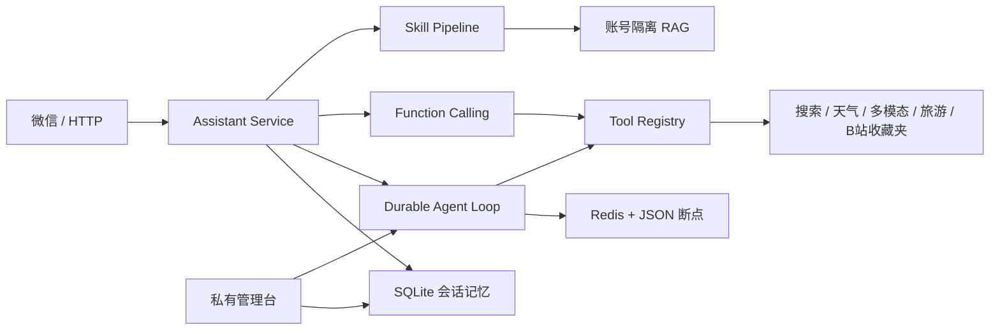

# WeChat Agent Platform

一个运行在微信中的多模态 AI 助手，也是一套由 Java 代码控制的可持久化 Agent Runtime。

系统基于 Java 21、Spring Boot 4、通义千问 DashScope Function Calling、Redis、SQLite 和微信 iLink 构建。普通消息支持知识库、联网搜索、天气、图片、语音、文档和提醒；复杂目标进入 Agent Loop，由框架负责状态、工具权限、预算、重试、超时、暂停恢复、人工接管与执行 Trace。

> 微信 iLink 为社区接入方案，建议仅使用测试账号低频运行。旅游票务模块默认提供规划、聚合适配层和安全外部结算入口，不声称已接入真实库存或支付。

## 核心亮点

- **可恢复 Agent Runtime**：每个推理边界保存断点，支持暂停、恢复、取消、重试、超时、Token/步骤预算和 Human-in-the-loop。
- **插件式扩展**：Agent 类型、Function Calling 工具和 Skill 均通过 Spring Bean 自动注册；已接入 Bilibili 收藏夹本地 SDK。
- **多模态微信助手**：支持文本、图片、音频、视频和 Office/PDF 文档处理。
- **账号隔离 RAG 与记忆**：SQLite 保存会话，Redis 提供任务索引与调度，本地文件负责故障降级。
- **可观测与安全**：私有管理台展示 Agent Trace、工具指标、P95/P99、用量和审计；包含限流、熔断、模型降级及日志脱敏。
- **工程化验证**：Maven Wrapper、JUnit 5、Mockito、JaCoCo 门禁、GitHub Actions 和容器化部署。

## 架构



## 快速开始

要求：JDK 21。Redis 可选；未启动时应用会降级到本地存储。

```powershell
$env:DASHSCOPE_API_KEY="your-key"
$env:QWEATHER_API_HOST="your-api-host"
$env:QWEATHER_API_KEY="your-key"
.\mvnw.cmd spring-boot:run
```

The default model provider is DashScope. For a local no-key smoke test, set
`APP_MODEL_PROVIDER=mock`; application and Agent Loop calls then use the built-in
mock provider instead of making external model requests.

健康检查：

```powershell
Invoke-RestMethod http://127.0.0.1:8080/actuator/health
```

如果要连接微信，在安全环境中设置 iLink 凭据并显式启用：

```powershell
.\mvnw.cmd spring-boot:run "-Dspring-boot.run.arguments=--assistant.ilink-enabled=true"
```

## Docker Compose

复制 `.env.example` 为 `.env`，填写必要环境变量后启动：

```powershell
docker compose up --build
```

服务仅映射到本机 `127.0.0.1:8080`，Redis 不暴露宿主机端口。

## 服务器发布

统一发布入口会执行构建与覆盖率门禁、上传制品、安装或更新 systemd 服务，并校验线上健康状态和制品哈希：

```powershell
.\deploy.ps1
```

## 测试与质量门禁

```powershell
.\mvnw.cmd clean verify
```

`verify` 会执行全部测试、生成 JaCoCo 报告并检查最低覆盖率。报告位于 `target/site/jacoco/index.html`，CI 配置位于 `.github/workflows/ci.yml`。

## 主要配置

| 环境变量 | 用途 | 必需 |
| --- | --- | --- |
| `APP_MODEL_PROVIDER` | Chat model provider (`dashscope` by default; `mock` for no-key local smoke tests) | No |
| `DASHSCOPE_API_KEY` | 大模型、多模态与联网搜索 | 核心对话必需 |
| `QWEATHER_API_HOST` / `QWEATHER_API_KEY` | 实时天气 | 天气功能必需 |
| `REDIS_URL` | Agent 调度、提醒与缓存 | 否，可降级 |
| `ADMIN_API_TOKEN` | 私有管理台认证 | 生产建议设置 |
| `ILINK_CREDENTIALS_FILE` | 微信 iLink 会话文件 | 微信接入必需 |
| `TRAVEL_SUPPLIER_API_URL` / `TRAVEL_SUPPLIER_API_KEY` | 真实票务供应商结算适配 | 真实票务必需 |
| `TRAVEL_RAIL_MCP_ENABLED` | 启用只读第三方 12306 MCP 查询 | 否，默认 `false` |

完整配置参见 [项目详细介绍](PROJECT-INTRODUCTION.md) 与 [技术文档](TECHNICAL-DOCUMENTATION.md)。

## Bilibili 收藏夹

项目已接入本地 SDK `com.bili.fav:java-fav:1.0.0`，并注册
`manage_bilibili_favorites` 工具和 `bilibili-favorites` Skill。支持：

- 获取收藏夹、同步视频元数据和字幕；
- 按标题、UP 主、简介或字幕检索本地视频；
- 将某个收藏夹的字幕幂等写入账号隔离知识库；
- 聊天命中收藏内容时提示“您的收藏夹中有对应的视频讲解”。

用户首次询问 B 站收藏夹时，Agent 会调用 Bilibili 官方二维码登录流程，并在管理控制台的对应 Agent
任务中展示二维码。登录凭据只保留在当前 Java 进程的内存中，严格绑定到该用户会话；重启后需重新扫码，
且绝不写入聊天、`application.properties`、`.env.example` 或 Git，也不会被其他用户或机器人项目复用。
当登录信息缺失时任务会进入 `WAITING_HUMAN`，扫码后恢复并从登录检查继续；空收藏夹、无匹配视频或无字幕
会如实结束。对于有字幕的视频，Agent 会基于字幕返回内容总结和要点，不会补造未出现在字幕中的信息。

也可以直接使用管理接口为一个等待登录的 Bilibili Agent 任务生成二维码：

```powershell
$headers = @{ "X-Admin-Token" = $env:ADMIN_API_TOKEN }
Invoke-RestMethod -Method Post -Headers $headers 'http://127.0.0.1:8080/api/admin/bilibili/task-login?taskId=<任务ID>'
Invoke-WebRequest -Headers $headers 'http://127.0.0.1:8080/api/admin/bilibili/task-qrcode.svg?taskId=<任务ID>' -OutFile bili-login.svg
```

上述管理接口仍受“仅本机/SSH 隧道访问”和 `ADMIN_API_TOKEN` 双重保护。
SDK 制品来源与重建方式见 [vendor 说明](vendor/README.md)。

## 能力边界

- 当前 RAG 使用可解释的词项相关性检索，不是向量数据库。
- HTTP `/api/chat` 是测试入口，不应直接作为正式多租户 API。
- 旅游模块内置行程演示目录；实时 POI、路况、库存与支付需要配置对应供应商。
- 铁路查询可选接入第三方 `12306-mcp@0.3.9`。它不是 12306 官方服务，仅用于只读余票查询；需 Node.js 18+，设置 `TRAVEL_RAIL_MCP_ENABLED=true` 后由 `npx` 启动。实名、下单、支付仍只在铁路 12306 官方页面完成。
- 管理台默认仅允许服务器本机或 SSH 隧道访问。

## 文档

- [Agent 平台设计与演示](AGENT-PLATFORM.md)
- [旅游 Agent 与票务边界](TRAVEL-AGENT.md)
- [Function Calling 开发规范](FUNCTION-CALLING.md)
- [微信 iLink 接入](ILINK-README.md)
- [Redis 会话设计](REDIS-MEMORY.md)

## 构建产物

```text
target/wechat-agent-platform-1.0.0-boot.jar
```

## License

[MIT](LICENSE)
