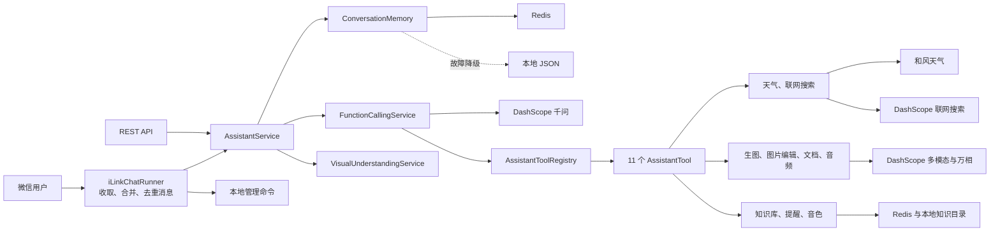

# 微信 AI 助手项目技术文档

## 1. 项目概述

本项目是一个基于 Spring Boot 的微信 AI 助手。微信消息通过社区版 iLink SDK 接入，模型能力由阿里云百炼 DashScope Java SDK 提供，天气等外部能力统一通过 Function Calling 暴露给模型。

当前主要能力：

- 普通多轮对话
- 实时天气和未来三天天气预报
- 图片、视频理解与多图比较
- 文生图并将图片直接回复到微信
- 对上传图片执行换背景、增删内容、风格变换、修复和增强
- 文档提取、总结与 DOCX 返回
- 音频文件识别、文字转语音及用户音色偏好
- 联网搜索并保留来源链接
- 可导入和检索的个人本地知识库
- Redis 持久化定时提醒与微信主动通知
- 工具成功率、耗时、会话和 Redis 状态监控
- Redis 会话记忆，24 小时滑动过期
- 微信附件接收提示、3 秒指令合并和近期附件复用

> iLink SDK 不是微信官方 SDK。生产使用前应单独评估账号风险，建议使用测试账号、小范围、低频运行。

## 2. 技术栈

| 类别 | 技术 |
| --- | --- |
| 运行环境 | Java 21 |
| 应用框架 | Spring Boot 4.1.0、Spring Web MVC |
| 大模型 SDK | DashScope Java SDK 2.22.15 |
| 微信接入 | `wechat-ilink-sdk` 2.3.3 |
| 会话存储 | Redis，故障时降级为内存与本地 JSON |
| 文档处理 | Apache POI 5.4.1、PDFBox 3.0.5 |
| 天气服务 | 和风天气 API |
| 构建测试 | Maven Wrapper、JUnit 5、Mockito |
| 服务器运行 | Linux、systemd、Redis |

## 3. 总体架构



### 3.1 代码目录

| 包 | 职责 |
| --- | --- |
| `chat` | 对话编排、Function Calling、视觉理解、图片生成、会话记忆和 HTTP 对话接口 |
| `tools` | 工具接口、注册表以及模型可调用的全部具体工具 |
| `ilink` | 微信登录、消息拉取、附件下载、消息合并、命令处理和回复发送 |
| `weather` | 城市检索、实时天气和三日预报 |
| `document` | 文档文字提取、总结、DOCX 生成和返回策略 |
| `audio` | ASR、TTS、音色选择及 HTTP 音频接口 |
| `search`、`knowledge` | 联网搜索和个人本地知识检索 |
| `reminder` | Redis 提醒存储、轮询和投递重试 |
| `monitoring` | 工具指标和管理状态接口 |
| `logging` | 请求日志和应用生命周期日志 |

## 4. 核心消息流程

### 4.1 普通文字消息

1. `IlinkChatRunner` 拉取消息，并按消息 ID 去重；程序启动前的积压消息不会重复回复。
2. 单独文字消息等待约 700 ms，以合并短时间内连续发送的内容。
3. `/help`、`/status`、`/version`、`/reset` 由本地管理命令处理，其余能力交给 Function Calling。
4. 普通问题进入 `AssistantService`，读取当前微信用户的会话历史。
5. `FunctionCallingService` 将系统提示、历史记录、当前问题和工具定义一起发送给模型。
6. 模型可直接回答，也可选择调用工具；最终文字或图片由 iLink 发回微信。

新消息到达后会递增用户消息版本。若旧回答尚未发出，会取消旧回答，避免回复已经过时的问题。

### 4.2 图片与文件的 3 秒合并

仅收到图片时，机器人立即回复：

```text
我已经接收到你的图片了。你想让我做什么呢？如果暂时不回复，我会在 3 秒后自动识别。
```

仅收到文件时，机器人立即回复相似提示，并说明 3 秒后自动总结。处理规则如下：

- 3 秒内收到文字：附件和文字合并为同一轮请求。
- 3 秒内没有文字：图片自动识别，文件自动总结。
- 后续文字提到“刚才的图片/文件”等内容：自动附带近期缓存的附件。
- 图片默认缓存 10 分钟；文件默认缓存 10 分钟。
- 多张图片会作为同一轮多模态输入，可执行比较和综合分析。
- 附件本体只保存在进程内存中，不写入 Redis；服务重启后近期附件缓存清空。

### 4.3 图片和视频理解

`VisualUnderstandingService` 把媒体转换成 DashScope 多模态输入，先提取可靠的画面事实。若用户只是要求识别图片，直接返回视觉结果；若用户要求比较、分析或修改，再把视觉事实和用户要求交给 Function Calling 层组织答案或调用图片生成工具。

### 4.4 文件处理

支持：DOC、DOCX、PDF、TXT、Markdown、CSV、XLS、XLSX、PPT、PPTX。

`DocumentSummaryService` 先在本地提取文字，再调用千问总结。出现以下情况会返回 DOCX 文件：

- 用户明确要求导出、生成或返回文件；
- 总结内容超过微信单条回复长度。

否则直接返回文字总结。

### 4.5 音频处理

- WAV、MP3、M4A、FLAC、OGG、OPUS、AAC、AMR、WMA 文件可进行语音识别。
- 微信原生语音气泡是 SILK，目前不支持，用户需要改发音频文件。
- `语音合成：文本` 或 `合成语音：文本` 会生成 WAV 文件。
- `/voices` 或“音色列表”查看音色；`/voice` 或“当前音色”查看当前选择；`切换音色：名称` 修改个人音色。
- 音色偏好保存在本地 JSON 文件中。

## 5. Function Calling 框架

### 5.1 运行机制

`FunctionCallingService` 使用 DashScope 的 `MultiModalConversation`：

1. `AssistantToolRegistry` 收集全部 `AssistantTool` Spring Bean。
2. 每个工具通过 `FunctionDefinition` 声明名称、说明和严格 JSON Schema。
3. 模型根据用户问题和工具说明决定是否调用工具。
4. 服务校验工具名与 JSON 参数，执行对应 Java 工具。
5. 工具结果通过带 `toolCallId` 的 `tool` 消息回传模型。
6. 模型结合结果生成面向用户的最终答案。

系统禁止并行工具调用，每个请求最多执行 4 轮工具调用。通常由模型自动选择工具；附件处理、明确文生图、图片编辑等入口带有确定性保护路由，防止模型只用文字声称任务已完成。

### 5.2 当前工具

| 工具名 | 参数 | 用途 |
| --- | --- | --- |
| `query_weather` | `city`、`queryType` | 查询实时天气或未来三天预报 |
| `generate_image` | `prompt` | 调用万相模型生成图片 |
| `edit_image` | `instruction` | 使用本轮图片执行指令编辑 |
| `search_web` | `query` | 联网搜索并返回来源 |
| `search_knowledge_base` | `query`、`limit` | 检索个人知识文件 |
| `add_to_knowledge_base` | `name` | 将上传文档持久化到知识库 |
| `manage_reminder` | `action` 等 | 创建、列出或取消提醒 |
| `process_document` | `instruction`、`output` | 总结、问答、翻译或导出文档 |
| `transcribe_audio` | `instruction` | 识别上传音频 |
| `synthesize_speech` | `text`、`voice` | 生成 WAV 语音 |
| `manage_voice` | `action`、`voice` | 查看或修改个人音色 |

### 5.3 新增工具规范

1. 在 `com.example.demo.tools` 下新建类，实现 `AssistantTool` 并标注 `@Component`。
2. 使用稳定且唯一的英文工具名。
3. 使用 `FunctionDefinition.builder()` 声明用途和 JSON Schema。
4. Schema 必须声明 `required`，并设置 `additionalProperties: false`。
5. `execute` 中仍须校验所有参数，不能直接信任模型参数。
6. 按结果类型返回 `ToolResult.text(...)`、`image(...)`、`document(...)` 或 `audio(...)`。
7. 为工具定义、参数校验、正常执行和异常路径编写单元测试。

最小结构：

```java
@Component
public class ExampleTool implements AssistantTool {
    @Override
    public FunctionDefinition definition() {
        return FunctionDefinition.builder()
                .name("example_tool")
                .description("清楚描述何时调用以及何时不要调用")
                .parameters(/* 严格 JSON Schema */)
                .build();
    }

    @Override
    public ToolResult execute(JsonNode arguments, ToolContext context) {
        // 再次校验参数，调用确定性服务。
        return ToolResult.text("结构化或可读结果");
    }
}
```

Spring 会自动注册该工具，不需要修改中央 `switch`。新功能默认通过工具描述交给模型选择，不要增加 `[TOOL:...]` 文本协议；只有必须保证执行的明确入口才增加最小化保护路由。

## 6. 对话记忆

### 6.1 Redis 数据模型

- 每个用户一个 Redis 字符串键。
- 键名为 `demo-assistant:conversation:` 加用户 ID 的 SHA-256，避免在键名暴露微信 ID。
- 值为 JSON，包含最近对话、旧对话摘要和最后访问时间。
- 默认保留最近 20 个完整轮次；更早内容压缩到最多 6000 字的摘要。
- 单条消息最多保存 4000 字。
- 每次读取或写入都会刷新 TTL；24 小时无活动后自动删除。

### 6.2 故障降级

Redis 不可用时，服务继续使用内存和 `/var/lib/demo-assistant/conversations.json`。Redis 恢复后，新消息会重新写入 Redis；首次启用 Redis 时，有效的本地会话会自动迁移。`/reset`、“清除对话”或“重新开始”会删除当前用户的 Redis、本地文件和内存会话。

本地 JSON 含会话内容，应保持数据目录仅服务账号可读写。

## 7. 微信命令

| 命令 | 作用 |
| --- | --- |
| `/help` | 显示帮助 |
| `/status` | 显示服务、模型和 API Key 配置状态 |
| `/version` | 显示 Bot 版本 |
| `/reset`、`清除对话`、`重新开始` | 清除当前用户对话记忆 |
| `/voices`、`音色列表` | 查看可用音色 |
| `/voice`、`当前音色` | 查看当前音色 |

## 8. HTTP 接口

服务默认仅监听服务器本机 `127.0.0.1:8080`。

### 8.1 对话

```http
POST /api/chat
Content-Type: application/json

{"question":"北京现在天气怎么样？"}
```

响应：

```json
{"answer":"..."}
```

该 HTTP 接口当前是无状态测试入口，不保存多轮会话。

### 8.2 天气

```http
GET /api/weather?city=北京
```

### 8.3 语音识别

```bash
curl -X POST http://127.0.0.1:8080/api/audio/recognize \
  -F 'file=@sample.wav'
```

### 8.4 语音合成

```bash
curl -X POST http://127.0.0.1:8080/api/audio/synthesize \
  -H 'Content-Type: application/json' \
  -d '{"text":"你好"}' \
  -o speech.wav
```

参数错误返回 HTTP 400；上游服务失败通常返回 HTTP 502；关键配置缺失返回 HTTP 503。

## 9. 配置

生产环境配置文件：

```text
/etc/demo-assistant/demo-assistant.env
```

### 9.1 必要环境变量

| 环境变量 | 说明 |
| --- | --- |
| `DASHSCOPE_API_KEY` | 阿里云百炼 API Key |
| `DASHSCOPE_BASE_URL` | DashScope 地址，默认官方 `/api/v1` 地址 |
| `QWEATHER_API_HOST` | 和风天气专属 API Host |
| `QWEATHER_API_KEY` | 和风天气 API Key |
| `REDIS_URL` | Redis 连接地址，默认 `redis://127.0.0.1:6379/0` |

### 9.2 常用可选变量

| 环境变量 | 默认值 | 说明 |
| --- | --- | --- |
| `DASHSCOPE_MODEL` | `qwen3.7-plus` | 对话与工具决策模型 |
| `DASHSCOPE_IMAGE_MODEL` | `wan2.7-image-pro` | 文生图模型 |
| `DASHSCOPE_IMAGE_SIZE` | `2K` | 图片尺寸档位 |
| `DASHSCOPE_IMAGE_EDIT_MODEL` | `wan2.7-image-pro` | 图片编辑模型 |
| `DASHSCOPE_IMAGE_EDIT_SIZE` | `2K` | 图片编辑输出尺寸 |
| `DASHSCOPE_ASR_MODEL` | `qwen3-asr-flash` | 语音识别模型 |
| `DASHSCOPE_TTS_MODEL` | `cosyvoice-v2` | 语音合成模型 |
| `DASHSCOPE_TTS_VOICE` | `longxiaochun_v2` | 默认音色 |
| `ILINK_BATCH_WINDOW_MS` | `3000` | 图片/文件等待文字指令的窗口 |
| `ILINK_RECENT_MEDIA_TTL_SECONDS` | `600` | 近期图片缓存时间 |
| `ILINK_RECENT_DOCUMENT_TTL_SECONDS` | `600` | 近期文件缓存时间 |
| `CONVERSATION_TTL_MINUTES` | `1440` | 会话滑动过期时间 |
| `CONVERSATION_MAX_TURNS` | `20` | 完整会话轮数上限 |
| `CONVERSATION_REDIS_ENABLED` | `true` | 是否启用 Redis |
| `CONVERSATION_REDIS_KEY_PREFIX` | `demo-assistant:conversation:` | Redis 键前缀 |
| `KNOWLEDGE_BASE_PATH` | `/var/lib/demo-assistant/knowledge` | 个人知识库目录 |
| `REMINDERS_ENABLED` | `true` | 是否启用提醒 |
| `REMINDERS_POLL_MS` | `10000` | 到期提醒扫描间隔 |
| `ADMIN_API_TOKEN` | 空 | 管理接口令牌；配置后请求必须携带该令牌 |

完整默认值以 `src/main/resources/application.properties` 为准。密钥只写入服务器环境文件，不要提交到 Git。

## 10. 构建与本地运行

运行全部测试并构建：

```powershell
.\mvnw.cmd clean test package
```

产物：

```text
target/demo-0.0.1-SNAPSHOT-boot.jar
```

本地启动微信接入：

```powershell
java -jar "D:\demo\target\demo-0.0.1-SNAPSHOT-boot.jar" `
  --assistant.ilink-enabled=true `
  --server.port=8080
```

首次启动需要扫码；登录凭据默认保存在 `${user.home}/.demo-ilink/credentials.json`。该文件包含令牌，禁止提交或分享。

## 11. 服务器部署与运维

### 11.1 首次安装

本地构建完成后运行：

```powershell
.\deploy-alibaba.ps1
```

脚本会上传 JAR 和安装器。服务器安装器负责准备 Java 21、Redis、服务账号、环境文件和 systemd 服务。

### 11.2 更新部署

```powershell
.\deploy-latest.ps1
```

更新脚本会自动计算当前 JAR 的 SHA-256，上传最新 JAR、准备 Redis、替换程序、重启服务，并强制校验上传文件和安装文件的哈希，同时输出服务状态和近期日志。

### 11.3 常用服务器命令

```bash
systemctl status demo-assistant --no-pager
systemctl restart demo-assistant
journalctl -u demo-assistant -n 100 --no-pager
journalctl -u demo-assistant -f
redis-cli ping
redis-cli --scan --pattern 'demo-assistant:conversation:*'
redis-cli --scan --pattern 'demo-assistant:reminder:*'
sha256sum /opt/demo-assistant/demo-assistant.jar
```

Redis 应只监听本机或可信私网，不能把 6379 端口暴露到公网。

### 11.4 运行监控

```bash
curl -H 'X-Admin-Token: 你的令牌' http://127.0.0.1:8080/api/admin/status
```

接口返回运行时长、堆内存、工具清单、每个工具调用次数/成功数/失败数/平均耗时、活跃会话、待执行提醒、Redis 状态和知识库目录。未设置 `ADMIN_API_TOKEN` 时仅建议在服务绑定本机地址的情况下使用。

## 12. 测试

单元和上下文测试：

```powershell
.\mvnw.cmd test
```

在线冒烟测试：

```powershell
.\smoke-live.ps1
```

冒烟测试覆盖服务状态、普通对话、实时天气、三日预报、图片生成、TTS、ASR、联网搜索、知识库检索、提醒列表、管理状态和 Function Calling 日志。图片编辑、文档附件处理与知识库导入需要通过微信发送真实附件验证。脚本会通过 SSH 连接服务器，需要手动输入服务器密码。

## 13. 开发约定与注意事项

- 控制器只负责协议校验，业务逻辑放在 Service 或 Tool 中。
- 外部实时能力优先封装为 `AssistantTool`，由模型根据工具说明选择。
- 工具必须再次校验参数，并将上游异常转换为清楚、可追踪的应用异常。
- 不在日志中输出 API Key、Redis 密码、iLink Token 或完整用户隐私数据。
- 图片和文件字节不要写入会话历史或 Function Calling JSON 参数。
- 修改消息合并、会话过期或工具循环时，必须补充并运行对应测试。
- 第三方 iLink SDK、DashScope SDK 和模型版本升级前，应先在测试账号与测试服务器验证。

## 14. 当前限制

- iLink 为第三方社区接入，不具备微信官方接口的稳定性保证。
- 微信原生 SILK 语音气泡暂不支持识别。
- 近期图片和文件缓存位于单机内存，不适合多实例横向扩容。
- HTTP `/api/chat` 当前不维护独立会话。
- 个人知识库当前采用轻量本地文本检索，适合个人项目；资料规模很大时应升级为向量检索和重排。
- 提醒投递依赖 iLink 会话在线；离线时会延迟 60 秒重试。
